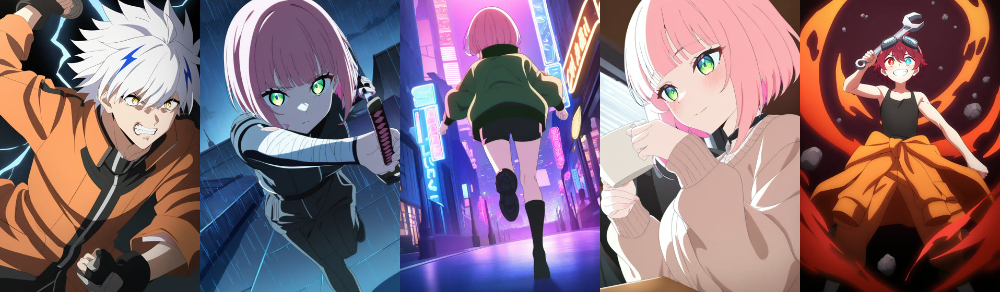
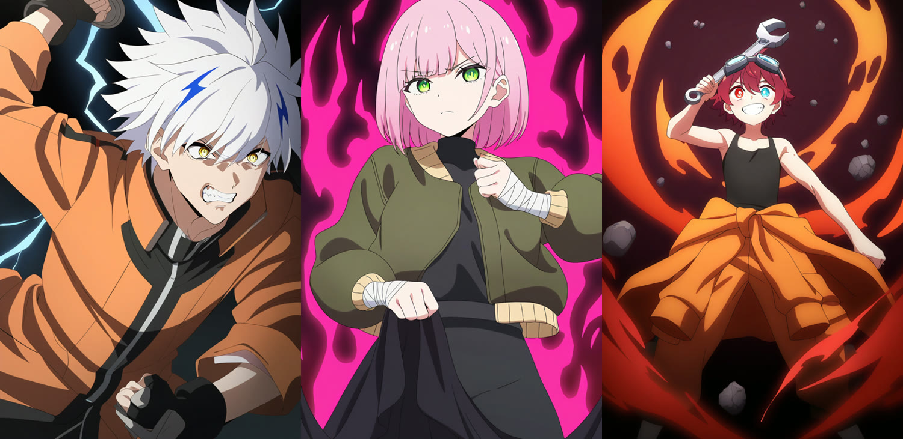
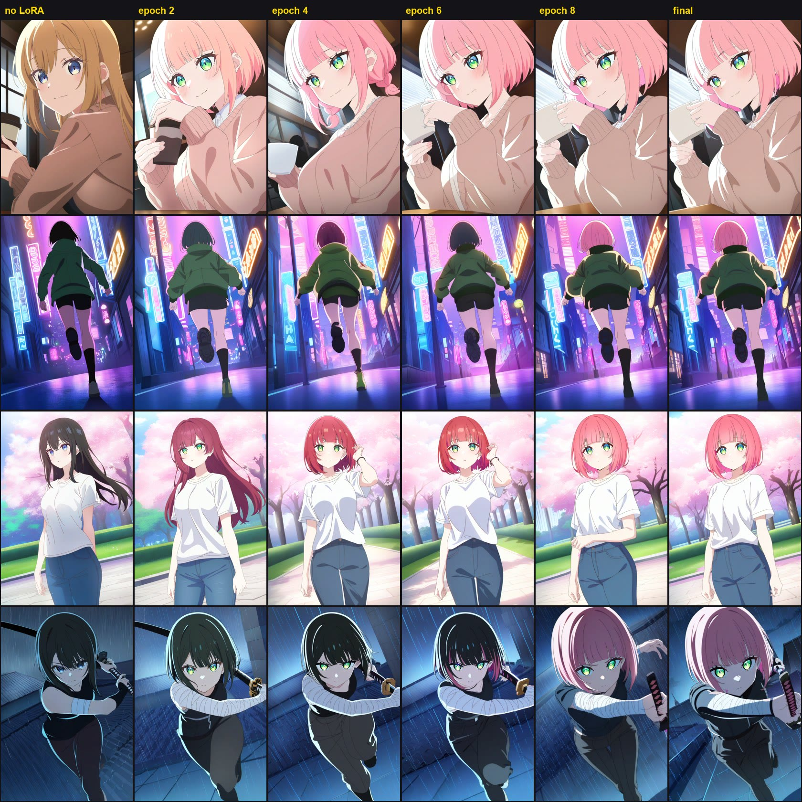
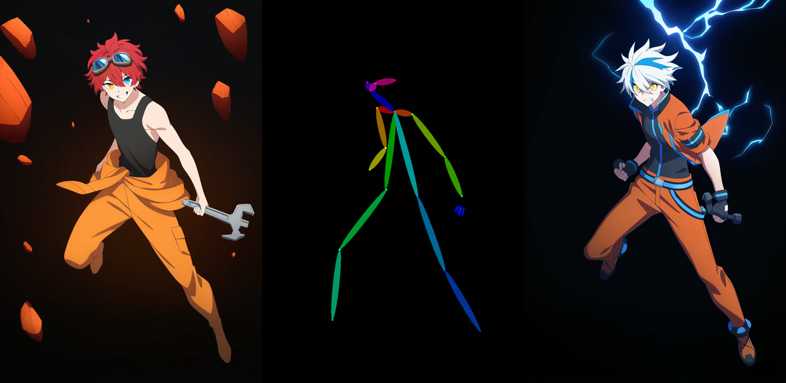
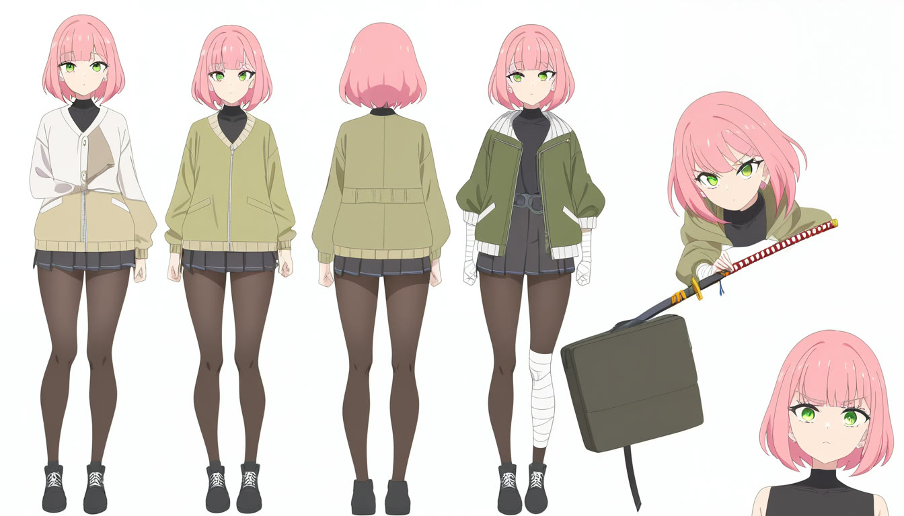
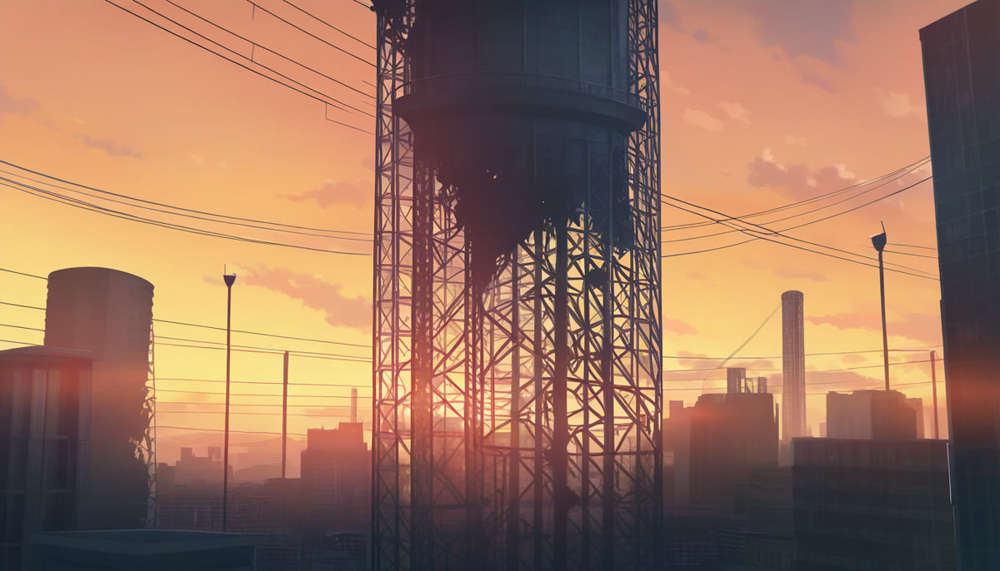
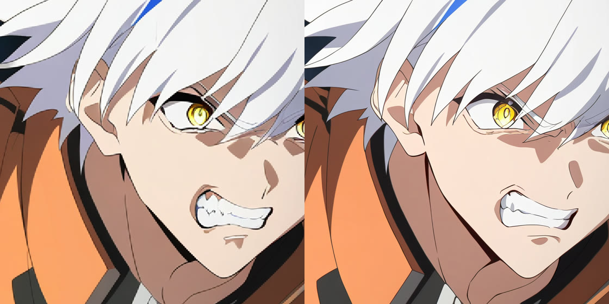
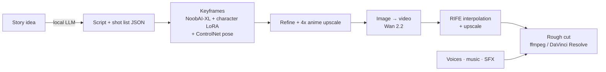

<div align="center">

# AnimeAI

### A local AI anime studio that runs on a gaming laptop

Original characters, consistent across every shot, drawn and animated **fully offline** on an 8 GB RTX 4060 Laptop GPU.
No cloud, no subscriptions, no per-image fees.



**[📄 Product overview (PDF)](docs/AnimeAI-Overview.pdf)** · **[🛠 Setup notes & benchmarks](docs/SETUP_NOTES.md)** · **[🧑‍🎨 Character training notes](project/characters/sumi/training_notes.md)**


</div>

---

## What it does

AnimeAI turns a story idea into short **2D Japanese-style anime scenes** in a modern shōnen action look: bold clean lineart, cel shading, dramatic lighting, dynamic camera. It chains open-source AI models into one pipeline and tunes each step to fit a mid-range laptop.

| Stage | What happens | Status |
|---|---|---|
| **Design** | Generate original characters, turnaround sheets and background plates | ✅ Working |
| **Pose** | Redraw any character in an exact pose from a reference image | ✅ Working |
| **Remember** | Train a small add-on (LoRA) so a character looks the same in every shot | ✅ Working |
| **Refine** | Anime-specific 4× upscale plus a detail pass for clean final keyframes | ✅ Working |
| **Animate** | Turn keyframes into 2–5 s video clips, then upscale and smooth them | 🚧 Next |
| **Write** | A local LLM turns a premise into a script and a machine-readable shot list | 📋 Planned |
| **Voice & sound** | Local text-to-speech voices, music and sound effects | 📋 Planned |
| **Assemble** | Batch-render the shot list overnight and stitch a rough cut for DaVinci Resolve | 📋 Planned |

## Results so far

### Original character concepts
Three characters designed from text alone. All characters in this project are original; no existing-anime character models are used.



### Character consistency: the core problem, solved
A base model draws a *different* person every time. After training a 46-minute LoRA on 37 curated images, the single trigger word `sumi_ink` brings back the same character (pink bob, blunt bangs, green eyes) in scenes she was never trained on. Her clothes still follow the prompt.


<sub>Rows: café · neon-city run · casual park · rainy sword fight. Columns: no LoRA → epoch 2, 4, 6, 8 → final. The prompts never mention hair or eye colour.</sub>

### Pose control
Extract the skeleton from any drawing, then redraw a different character in exactly that pose.



### Turnaround sheets, backgrounds, upscaling
| Turnaround sheet | Background plate |
|---|---|
|  |  |

| Before / after refine + upscale (832×1216 → 1248×1824) |
|---|
|  |

## Performance on an 8 GB laptop

Measured on an Acer Nitro V 16 (RTX 4060 Laptop 8 GB, i5-14450HX, 16 GB single-channel DDR5).

| Task | Time | Peak VRAM |
|---|---|---|
| Anime keyframe, 832×1216, 28 steps | **18 s** | 7.5 GB |
| Pose-controlled keyframe | 51 s | 7.3 GB |
| Refine + 4× anime upscale | 55 s | 7.7 GB |
| Character LoRA training (1,480 steps) | **46 min** | 5.8 GB |

**Tuning findings** (details in [SETUP_NOTES](docs/SETUP_NOTES.md)):
- The laptop's quiet thermal profile silently capped the GPU at 1.2 GHz / 20 W. Switching NitroSense to **Turbo** made everything **~1.6–2.7× faster**.
- `--fast fp16_accumulation` gave another 14% on RTX 40-series, with no visible quality loss.
- `--highvram` looks faster but pushes SDXL + ControlNet past 8 GB, and Windows then spills into shared memory at **225 s per step**. Avoided.
- An 8 GB-safe LoRA recipe: fp8 base weights, UNet-only training, cached latents and text-encoder outputs → 5.8 GB peak.

## How it works



Everything runs through **ComfyUI's HTTP API** from small Python scripts. Every workflow is stored as JSON (`workflows/*.api.json`) and generated in code, so a batch job can fill in prompts, seeds and sizes by node ID and run hundreds of shots unattended.

### Stack
| Layer | Tool | Licence |
|---|---|---|
| Engine | [ComfyUI](https://github.com/Comfy-Org/ComfyUI) v0.37 portable (PyTorch 2.13, CUDA 13) | GPL-3.0 |
| Anime model | [NoobAI-XL v1.1](https://huggingface.co/Laxhar/noobai-XL-1.1) (SDXL / Illustrious family) | fair-ai-public-license-1.0-sd |
| Pose / structure | [xinsir ControlNet Union ProMax](https://huggingface.co/xinsir/controlnet-union-sdxl-1.0) + OpenPose | Apache-2.0 |
| Upscalers | [4x-AnimeSharp](https://huggingface.co/Kim2091/AnimeSharp) (non-commercial) · [RealESRGAN x4plus anime](https://github.com/xinntao/Real-ESRGAN) (commercial-safe) | CC BY-NC-SA 4.0 · BSD-3 |
| LoRA training | [kohya-ss/sd-scripts](https://github.com/kohya-ss/sd-scripts) v0.12 | Apache-2.0 |
| Auto-captioning | [WD14 tagger v3](https://huggingface.co/SmilingWolf/wd-vit-tagger-v3) | Apache-2.0 |
| Video (next) | Wan 2.2 (TI2V-5B / I2V-14B GGUF), RIFE | Apache-2.0 / MIT |

## Project layout

```
AnimeAI/
├─ run_comfyui.bat            # start the engine (tuned flags for 8 GB)
├─ scripts/
│  ├─ comfy_api.py            # tiny ComfyUI API client: queue, wait, stats, free VRAM
│  ├─ build_sdxl_workflows.py # generates all image workflows as API JSON
│  ├─ gen_lora_dataset.py     # varied training images for a character
│  ├─ lora_pipeline.py        # prep (WD14 captions) + train (8 GB-safe sd-scripts config)
│  ├─ test_lora.py            # checkpoint-vs-checkpoint comparison grid
│  ├─ contact_sheet.py        # numbered sheets for curating images
│  └─ bench_sdxl.py / test_phase3*.py
├─ workflows/                 # txt2img · pose · turnaround · background · refine+upscale
├─ project/
│  ├─ characters/<name>/      # character.json, training notes, test grid
│  ├─ backgrounds/  keyframes/  clips/  audio/  edit/
└─ docs/                      # overview PDF, setup notes, images
```

## Quick start

> **Hardware:** NVIDIA RTX GPU with 8 GB+ VRAM, 16 GB+ RAM (32 GB recommended), ~100 GB free disk. Windows 11.

1. **Engine.** Download the [ComfyUI Windows portable (NVIDIA)](https://github.com/Comfy-Org/ComfyUI/releases/latest) build and extract it to `AnimeAI/comfyui/`. Install the custom nodes into `comfyui/ComfyUI/custom_nodes/`: [ComfyUI-GGUF](https://github.com/city96/ComfyUI-GGUF), [VideoHelperSuite](https://github.com/Kosinkadink/ComfyUI-VideoHelperSuite), [KJNodes](https://github.com/kijai/ComfyUI-KJNodes), [Frame-Interpolation](https://github.com/Fannovel16/ComfyUI-Frame-Interpolation), [controlnet_aux](https://github.com/Fannovel16/comfyui_controlnet_aux). Then run `pip install -r requirements.txt` for each one with `comfyui\python_embeded\python.exe -s -m pip ...`, plus `manager_requirements.txt`.
2. **Models.** Put `NoobAI-XL-v1.1.safetensors` in `models/checkpoints/`, the ControlNet Union ProMax file in `models/controlnet/`, and the upscalers in `models/upscale_models/` (links in the Stack table).
3. **Workflows.** `comfyui\python_embeded\python.exe scripts\build_sdxl_workflows.py`
4. **Run.** Set the laptop to its **performance/turbo** profile, start `run_comfyui.bat`, and open http://127.0.0.1:8188.
5. **Trainer (optional).** Clone `kohya-ss/sd-scripts` v0.12.0 into `trainers/sd-scripts`, then create a Python 3.10 venv with torch 2.8.0+cu128 and its `requirements.txt` (plus `onnx onnxruntime-gpu`).

### Make a consistent character
```bat
:: 1. describe them in project\characters\<name>\character.json, start ComfyUI, then:
comfyui\python_embeded\python.exe scripts\gen_lora_dataset.py <name> 48
:: 2. delete the off-model images in project\characters\<name>\candidates\
:: 3. close ComfyUI, then caption and train (~45 min):
trainers\sd-scripts\venv\Scripts\python.exe scripts\lora_pipeline.py prep  <name>
trainers\sd-scripts\venv\Scripts\python.exe scripts\lora_pipeline.py train <name>
:: 4. start ComfyUI again and compare checkpoints:
comfyui\python_embeded\python.exe scripts\test_lora.py <name>
```

## Roadmap

- [x] **Phase 0–1** Hardware audit, disk/RAM plan, project structure
- [x] **Phase 2** ComfyUI engine + launch-flag benchmarking
- [x] **Phase 3** Still-image workflows: characters, pose, turnaround, backgrounds, refine/upscale
- [x] **Phase 4** Character LoRA training on 8 GB
- [ ] **Phase 5** Image → video with Wan 2.2 (5B vs 14B GGUF), first/last-frame control, RIFE + upscale
- [ ] **Phase 6** Local LLM storyboard: premise → script → shot-list JSON
- [ ] **Phase 7** Voices (GPT-SoVITS / Kokoro), music, sound effects
- [ ] **Phase 8** Resumable overnight batch renderer + automatic rough cut
- [ ] **Phase 9** 15–20 s end-to-end test scene

## Responsible use

- **Original characters only.** The project deliberately avoids models and LoRAs that reproduce existing anime characters.
- **Licences travel with the models.** NoobAI-XL outputs are free to use, but models derived from it must stay open (FAIPL). 4x-AnimeSharp is non-commercial, so use the RealESRGAN anime model for anything monetised.
- Voice cloning (Phase 7) will only use voices the author has the rights to.

## Author

**Md Zahidul Haque**, AI & Computer Engineering student at Tongmyong University, Busan.
[GitHub](https://github.com/zahiddiff) · [LinkedIn](https://www.linkedin.com/in/haquemdzahidul/) · [Portfolio](https://zahiddiff.github.io/)

<sub>The code in this repository is MIT-licensed (see <a href="LICENSE">LICENSE</a>). Models and third-party tools keep their own licences, listed above.</sub>
